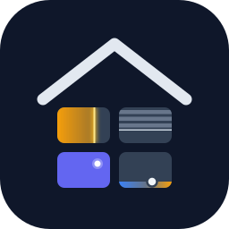

# HA Auto Dashboard

Lovelace-Dashboard-Strategy, die das Dashboard aus Areas, Floors, Devices und Entities erzeugt. Idee wie bei Dwains Dashboard, aber ohne Blueprints, Wandtablet-Modus und Zusatzkarten. Die Optik kommt aus HArmony: Slate-Palette, Indigo-Akzent, Amber-Glow bei Licht, runde Status-Buttons.

Ein ES-Modul (~140 KB, ~39 KB gzip), einzige Abhängigkeit ist Lit. Keine anderen Custom Cards nötig.

## Was erzeugt wird

- **Zuhause**: Begrüßung, Uhrzeit, Wetter, Personen (zu Hause oder unterwegs) und Alarmanlage, Status-Chips (Licht an, offen, unverriegelt, heizt, spielt, Batterie < 20 %, nicht erreichbar; ein Tipp klappt die Liste auf), Innen- und Außenklima und aktueller Stromverbrauch, „Läuft gerade“, eine Zeile mit Szenen und Skripten, Favoriten, darunter eine Raumkarte pro Area, gruppiert nach Etage. Ganz unten die To-do-Listen mit ihrem Namen (HAs eigene Karte, Einträge lassen sich direkt abhaken). Welche erscheinen, legt `todo_lists` fest; `hide_domains: [todo]` blendet alle aus.
- **Raumseiten** (`area-<area_id>`, Subview): oben Temperatur, Luftfeuchte und, wenn der Raum genau ein Thermostat hat, Ist- und Solltemperatur mit −/+. Daneben Schnellkacheln „Licht 2 von 5 an“, „Steckdosen“ und je eine pro Rollo-Art, die alles im Raum auf einmal schalten. Darunter die Favoriten des Raums und die Gruppen Licht, Klima, Beschattung, Fenster & Türen, Tore, Schlösser, Medien, Schalter, Auswahl, Bewegung & Anwesenheit, Sicherheit & Alarm, Sensoren, Szenen. Gruppen mit mehreren Lichtern, Steckdosen, Rollos oder Schlössern haben einen Sammelschalter in der Überschrift. Gemeinsam geschaltet werden nur Lichter, Ventilatoren und Schalter mit der Geräteklasse `outlet`; andere Schalter sind oft Geräteeinstellungen (Kindersicherung, Eco-Modus) und bleiben außen vor.
- **Domain-Seiten**: Licht (mit „Alle aus“), Klima, Rollos (mit „Alle zu“, nur Beschattung), Sicherheit (Fenster, Türen, Tore, Schlösser, Bewegung, Rauch- und Wassermelder). Nach Raum gruppiert, nur wenn es passende Entities gibt. Jede Raum-Überschrift führt zur Raumseite und hat einen Schalter mit „2/5“, bei Rollos auf/zu, bei Schlössern verriegeln/entriegeln. Entriegeln fragt immer erst nach.
- **Kameras** (`cameras`, mit Eintrag in der Navigationsleiste): alle Kameras mit Live-Bild, nach Etage und Raum gruppiert, jede Raum-Überschrift führt zur Raumseite. Die Kameras eines Raums stehen zusätzlich oben auf seiner Raumseite.
- **Energie** (`energy`, nur mit Leistungssensoren): das ganze Haus mit dem Raum, der am meisten verbraucht, und dessen drei größten Verbrauchern. Darunter jeder Raum mit seinen Leistungssensoren und ihrem Anteil, darunter ein Verlauf der letzten 24 Stunden (HAs Verlaufsgraph). Erreichbar über die Kachel „Strom“ auf der Startseite.
- **Wartung** (`maintenance`): alle Batterien, schwächste zuerst, nicht erreichbare Geräte und, nur für Admins, ausstehende Updates. Erreichbar über die Chips „Batterie“ und „Nicht erreichbar“ → „Alle anzeigen“.
- **Navigation**: schwebende Leiste unten auf allen Geräten. Licht, Klima, Rollos, Sicherheit, Kameras und die Räume sind Unteransichten, deshalb blendet HA seine eigene Tab-Leiste aus.

**Rollos nach Zweck:** Rollläden, Jalousien, Markisen und Rollos ohne Geräteklasse zählen als Beschattung. Rollos mit der Klasse `window` oder `door` gehören zu Fenster & Türen, `garage` und `gate` zu Tore. Jede Art hat ihre eigene Schnellkachel und ihren eigenen Sammelschalter, „Alle zu“ für die Beschattung fährt also nie das Garagentor. Die Geräteklasse lässt sich in HA in den Einstellungen des Entities unter „Anzeigen als“ ändern.

**Läuft gerade:** erscheint, sobald ein Player spielt, mit Cover, Titel, Raum, Play/Pause und Weiter. Bei mehreren Playern schaltet „+N“ weiter. Ein pausierter Player bleibt fünf Minuten stehen. Mit `hide_domains: [media_player]` verschwindet die Leiste.

**Innen, Außen, Strom:** „Innen“ ist der Durchschnitt aller Räume, „Außen“ der Durchschnitt der Bereiche in `outdoor_areas` (Garten, Terrasse). Außenbereiche zählen innen nicht mit. „Strom“ kommt aus HAs Energieeinstellungen, wenn sie eindeutig sind: ein Hausverbrauch-Sensor, sonst genau eine Netzquelle mit Leistungssensor (plus Solar und Akku). Mehrere Netzquellen mit Leistungssensor sind meist einzelne Steckdosen und werden ignoriert. Die Energieseite zeigt die drei dann einzeln. Ohne diese Angaben (oder für Nutzer ohne Zugriff darauf) ist „Strom“ die Summe aller Leistungssensoren (`device_class: power`) in den Räumen; ein Gesamtzähler in einem Raum zählt dann doppelt und lässt sich per Label ausblenden.

**Personen und Alarm:** Alle sichtbaren `person`-Entities als Avatar, unterwegs ausgegraut, dazu die erste Alarmanlage als Chip (ausgelöst rot und blinkend, scharf blau, unscharf grün). Ausblenden mit `hide_domains: [person]` bzw. `[alarm_control_panel]` oder dem Label `ad_hide`.

Temperatur und Luftfeuchte eines Raums kommen aus den Sensoren, die in HA beim Bereich eingetragen sind (Einstellungen → Bereiche → Bereich öffnen). Ohne diese Angabe nimmt das Dashboard, was das Thermostat misst, und erst danach den ersten funktionierenden Sensor im Raum. Steht im Raum ein Kühlschrank- oder Außenthermometer, trägt man den richtigen Sensor deshalb am besten beim Bereich ein.

Mehrere Tipps auf −/+ am Thermostat werden gesammelt und nach einer kurzen Pause als ein Befehl geschickt.

Bedienung: Raumkarte antippen öffnet die Raumseite, Doppeltipp schaltet alle Lichter im Raum, ein Tipp auf einen Status-Kreis öffnet den More-Info-Dialog. Kacheln: Tippen schaltet Licht, Schalter und Szenen, alles andere öffnet More-Info. Lange drücken öffnet immer More-Info.

**Kacheln zeigen die Menge, die sie steuern:** Eine Lichtkachel füllt sich mit warmem Licht bis zur Helligkeit; waagerecht über die Kachel ziehen dimmt, die Pfeiltasten auch. Rollos zeigen ihre Lamellen so weit geschlossen, wie sie es sind. Thermostate haben unten einen Streifen von kalt nach warm mit Punkt (gemessen) und Strich (Soll), Prozentwerte wie Luftfeuchte einen Füllstreifen. Schalter und Sensoren sind Zeilen wie ein Wandschalter: die ganze Zeile schaltet, die Kontrolllampe rechts zeigt den Zustand.

## Installation

Voraussetzung: Home Assistant 2026.5 oder neuer.

### Über HACS (empfohlen)

1. HACS öffnen → Menü oben rechts → **Benutzerdefinierte Repositories**.
2. `https://github.com/frcarlo/ha-auto-dashboard` eintragen, Typ **Dashboard**, hinzufügen.
3. **Auto Dashboard** suchen und herunterladen. HACS trägt die Ressource selbst ein.
4. Browser neu laden (Strg+Shift+R) bzw. in der Companion-App den Frontend-Cache zurücksetzen.
5. **Einstellungen → Dashboards → Dashboard hinzufügen**. Unter **Community-Dashboards** steht jetzt **Auto Dashboard**. Auswählen, Namen vergeben, fertig.

Updates kommen danach wie bei jedem HACS-Plugin.

### Manuell

1. `auto-dashboard.js` aus dem [neuesten Release](https://github.com/frcarlo/ha-auto-dashboard/releases/latest) nach `/config/www/auto-dashboard/` kopieren.
2. **Einstellungen → Dashboards → Ressourcen** → `/local/auto-dashboard/auto-dashboard.js?v=0.1.0`, Typ **JavaScript-Modul**. Bei jedem Update die Versionsnummer hochzählen, sonst bleibt die alte Datei bis zu 31 Tage im Cache.
3. Browser neu laden, dann wie oben über **Dashboard hinzufügen** anlegen. Alternativ ein leeres Dashboard anlegen und in der Rohkonfiguration eintragen:
   ```yaml
   strategy:
     type: custom:auto-dashboard
   ```

### Theme (optional)

`themes/harmony.yaml` nach `/config/themes/` legen (`frontend: themes: !include_dir_merge_named themes`) und im Profil **HArmony** wählen. Dann passen Hintergrund, Kopfzeile und Seitenleiste zu den Karten.

## Optionen

Am einfachsten über den Editor: Dashboard öffnen → Stift oben rechts → **Dashboard bearbeiten**. Der Editor hat die Reiter Darstellung, Startseite, Haus, Raumseiten und Nutzer. Unter „Haus“ ist das Haus als Querschnitt gezeichnet: Etagen übereinander, Räume darin, Räume ohne Etage draußen. Oben wählst du, was ein Tipp auf einen Raum bewirkt (ausblenden, Außenbereich, nur diesen zeigen), und jeder Raum zeigt seine Rolle direkt in der Zeichnung; ein Tipp auf eine Etage zeigt nur diese Etage. Dieselbe Zeichnung wählt unter „Raumseiten“ den Raum zum Anpassen und in den Nutzerregeln die Räume, die jemand sieht. Den Editor sehen nur Admins, weil nur sie Dashboards bearbeiten dürfen. Gespeichert wird dieselbe YAML-Konfiguration wie unten, ohne Standardwerte. Nutzerregeln aus dem Editor sind an die User-ID gebunden, eine Umbenennung bricht sie deshalb nicht.

Alle Optionen, alle optional:

```yaml
strategy:
  type: custom:auto-dashboard
  title: Zuhause
  theme: auto              # auto | dark | light, auto folgt dem HA-Dunkelmodus
  glass: false             # Milchglas-Karten (auf Touch-Geräten ohne Blur)
  primary_color: "#14b8a6" # Akzentfarbe, alles andere wird daraus abgeleitet
  ha_colors: true          # mit primary_color auch HA-Kopfzeile, Seitenleiste und Dialoge färben
  nav_position: bottom     # bottom | top | left | right
  areas: [wohnzimmer]      # nur diese Räume
  floors: [obergeschoss]   # nur Räume auf diesen Etagen
  hide_areas: [abstellraum]
  area_order: [wohnzimmer, kueche]   # sonst alphabetisch je Etage
  hide_domains: [fan, scene]
  hide_labels: [technik]   # Label-IDs, siehe unten
  favorites: [light.flur, lock.haustuer]       # Startseite und oben im jeweiligen Raum
  scenes: [scene.kino, script.gute_nacht]      # Zeile auf der Startseite
  todo_lists: [todo.einkaufsliste]             # Listen auf der Startseite, sonst alle
  outdoor_areas: [garten]  # Durchschnitt als „Außen“
  hide_entities: [light.deko]   # einzelne Geräte überall ausblenden
  rooms:                   # Einstellungen pro Raumseite, siehe unten
    wohnzimmer:
      hide_groups: [sensor]
      group_order: [media, light]
      order: [light.decke, light.stehlampe]
      cards:
        top:
          - type: markdown
            content: Willkommen
        light: []          # am Ende einer Gruppe
        bottom: []
```

**Raumseiten anpassen:** Am einfachsten im Editor unter „Raumseiten“. Raum wählen, dann Gruppen und Geräte mit den Pfeilen sortieren und mit dem Auge ausblenden. Ausgeblendete Geräte (`hide_entities`) verschwinden überall im Dashboard, ausgeblendete Gruppen (`hide_groups`) nur auf dieser Raumseite. Eigene Karten sind normale Lovelace-Karten und landen oben (`top`), unten (`bottom`) oder am Ende einer Gruppe (Gruppenname wie `light`, `climate`, `shading`, `opening`, `gate`, `lock`, `media`, `switch`, `select`, `motion`, `safety`, `sensor`, `scene`). „Raum zurücksetzen“ macht die Seite wieder automatisch.

**Raumbild:** Hat ein Bereich in HA ein Bild (Einstellungen → Bereiche → Bereich bearbeiten), steht der Raumname auf diesem Bild.

**Szenen und Skripte:** Ohne `scenes` zeigt die Startseite alle sichtbaren Szenen, alphabetisch. Skripte erscheinen nur, wenn sie in `scenes` stehen. Mit `hide_domains: [scene]` verschwindet die Zeile.

**Akzentfarbe:** `primary_color` nimmt eine Hex-Farbe. Daraus entstehen für hell und dunkel der Seitenhintergrund, die Kartenflächen, die Schrift, der Akzent (aktive Navigation, Play-Knopf, Status-Punkte) und das Info-Blau. Die Flächen bekommen einen leichten Stich des Farbtons, wie das Schiefergrau beim voreingestellten Indigo; ein Grau als Akzent ergibt neutrale Grautöne. Bei hellen Akzenten wird die Schrift darauf dunkel. Gelb für Licht und Heizen, Rot für Alarm und Grün für „in Ordnung“ bleiben gleich, damit man sie auf einen Blick erkennt. Solange das Dashboard offen ist, übernehmen auch HAs Kopfzeile, Seitenleiste und Dialoge (z. B. der Detail-Dialog) die Farben; beim Verlassen kommt das HA-Theme zurück. Mit `ha_colors: false` bleibt HA, wie es ist. Ohne die Option bleibt die HArmony-Palette und der Seitenhintergrund kommt aus dem HA-Theme. Im Editor gibt es dafür Farbvorschläge und einen Farbwähler.

**Navigationsleiste:** `left` und `right` sind eine senkrechte Leiste am Rand, ab 1024 px Breite. Der Inhalt rückt dafür ein. Auf schmaleren Bildschirmen sitzt die Leiste unten. `top` setzt sie unter die HA-Kopfzeile.

**Nur ein Raum oder eine Etage:** `areas` und `floors` beschränken das ganze Dashboard, also Startseite, Status-Chips, Übersichten und Raumseiten. Beide zusammen ergeben die Schnittmenge. Mit genau einem Raum zeigt die Startseite gleich dessen Inhalt, praktisch für ein Wandtablet. Die IDs stehen unter Einstellungen → Bereiche, Etagen & Zonen in der URL des Bereichs bzw. der Etage.

### Nutzer

Pro HA-Nutzer lässt sich festlegen, was er sieht und bedienen darf:

```yaml
strategy:
  type: custom:auto-dashboard
  users:
    leni:                          # Vorname, voller Name oder User-ID
      areas: [zimmer_leni, wohnzimmer]
      floors: [obergeschoss]
      hide_pages: [security]       # lights | climate | covers | security | cameras | energy | maintenance
      control_critical: false      # keine Schlösser, Alarmanlage, „Alle aus/zu“
    gast:
      read_only: true              # nur ansehen
    default:                       # alle übrigen Nicht-Admins
      control_critical: false
```

- Admins ohne eigenen Eintrag sehen und bedienen alles. Mit einem eigenen Eintrag gilt auch für sie die Regel.
- `areas` und `floors` gelten zusätzlich zu den Filtern des Dashboards.
- Was jemand nicht bedienen darf, erscheint ohne Schalter und Knöpfe. HAs Detail-Dialog öffnet sich dafür ebenfalls nicht, sonst ließe sich darüber schalten. Reine Anzeigen wie Sensoren öffnen weiter ihre Infos.

**Wichtig:** Das ist keine Sicherheitsfunktion. HA kennt keine Rechte pro Raum oder Gerät. Wer angemeldet ist, kann über andere Dashboards, die Einstellungen oder die API weiterhin alles schalten. Die Regeln eignen sich für Kinder-Tablets, Gäste und Wandpanels, nicht zum Schutz gegen jemanden, der es darauf anlegt. Wer nur dieses Dashboard sehen soll, bekommt in HA keine Admin-Rechte, und die anderen Dashboards werden über „Nur für Admins sichtbar“ ausgeblendet.

**Ausblenden per Label:** Entities mit dem Label `ad_hide` erscheinen nie. Mit `hide_labels` kommen eigene Labels dazu. Dabei zählt das Label am Entity, am Gerät und am Bereich: Ein Gerät mit dem Label verschwindet mit allen seinen Entities, ein Bereich mit allen Geräten darin. Die Label-ID steht unter Einstellungen → Bereiche, Labels & Zonen → Labels; im Editor wählt man die Labels einfach an.

Versteckte Entities und Diagnose-/Konfigurations-Entities erscheinen ohnehin nicht. Die Area eines Entities ist seine eigene oder die seines Geräts.

## Entwicklung

```bash
npx vite        # Testseite mit Mock-Daten: http://localhost:5173/dev/index.html
npm run dev     # Build im Watch-Modus
npm test        # Vitest für Modell, Darstellung und Strategy
npm run deploy  # Bundle nach HA_WWW_TARGET kopieren (Samba-Mount oder scp)
npm run push    # Bundle als Inline-Resource per WebSocket (HA_URL/HA_TOKEN in .env)
```

Die Testseite (`dev/`) rendert die generierten Views ungefähr so wie HAs Sections-View, mit Fake-States aus `dev/mock.ts`. Service-Aufrufe ändern die Fake-States, More-Info erscheint als Toast. `?theme=light` und `?glass` schalten die Optik um.

| Datei | Inhalt |
|---|---|
| `src/strategy.ts` | erzeugt Views und Sections |
| `src/model.ts` | Areas, Etagen, Gruppen, Status-Zähler (reine Funktionen) |
| `src/presentation.ts` | Icons, aktiv/inaktiv, Farben (Port aus HArmony) |
| `src/styles/tokens.ts` | Farben, Kartenform, Glas |
| `src/cards/*` | `ad-tile`, `ad-room-card`, `ad-status-bar`, `ad-header`, `ad-nav-bar` |

## Release

Ein GitHub-Release mit Tag `vX.Y.Z` veröffentlichen. Der Workflow `release.yml` setzt die Version, baut und hängt `auto-dashboard.js` an das Release. Von dort lädt HACS die Datei.
